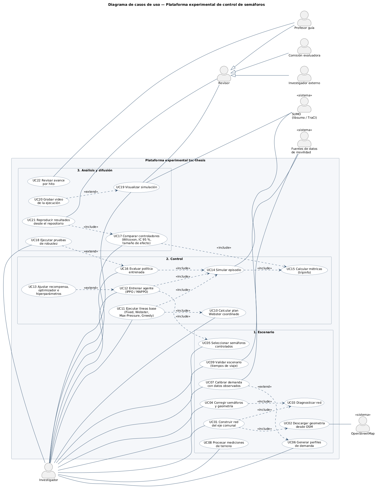

# Control adaptativo de semáforos mediante aprendizaje por refuerzo multi-agente

Proyecto de título — Ingeniería en Informática, DUOC UC
Gabriel Ignacio Cárdenas Valdés · Entrega: diciembre de 2026

Evaluación comparativa entre control clásico de semáforos (tiempo fijo, Webster,
Max-Pressure) y agentes MARL sobre una red real de Santiago simulada en SUMO. El
MVP es el eje Alameda → Providencia → Apoquindo dentro de los límites comunales
de Santiago, Providencia y Las Condes.

## Por dónde empezar

1. **[`ESTADO_DEL_PROYECTO.md`](ESTADO_DEL_PROYECTO.md)** — dónde está el proyecto hoy y qué sigue.
2. **[`docs/00-INDICE.md`](docs/00-INDICE.md)** — índice de toda la documentación.
3. **[`tsc-thesis/README.md`](tsc-thesis/README.md)** — cómo instalar y correr el pipeline.
4. **[`docs/uml/`](docs/uml/README.md)** — actores y casos de uso del sistema.
5. **[`docs/arquitectura.md`](docs/arquitectura.md)** — app, backend Go y simulación: cómo se comunican y cómo levantarlos.



## Mapa del repositorio

Importancia: ★★★ esencial · ★★ referencia de trabajo · ★ archivo / fuera de alcance.

| Ruta | Contenido | Importancia |
|---|---|---|
| `ESTADO_DEL_PROYECTO.md` | Informe de estado, avance por objetivo y hoja de ruta | ★★★ |
| `docs/anteproyecto/` | Anteproyecto entregado (DOCX, PDF y texto plano) | ★★★ |
| `docs/informe/` | Borrador del informe final | ★★★ |
| `docs/decisiones/` | Decisiones registradas: escenario, tiempos semafóricos, agente, base de datos, entorno | ★★★ |
| `tsc-thesis/src/`, `tsc-thesis/scripts/`, `tsc-thesis/tests/` | Código de la plataforma experimental | ★★★ |
| `tsc-thesis/scenarios/eje_comunal/` | Red del MVP | ★★★ |
| `docs/datos/` | Fuentes de datos y protocolo de terreno | ★★ |
| `docs/entorno/` | Stack, montaje y visualización | ★★ |
| `docs/uml/` | Modelo de casos de uso (PlantUML + SVG/PNG) | ★★ |
| `backend/` | Backend Go: API `/v1` para la app, lógica de negocio y clientes de los demás servicios | ★★★ |
| `simulacion/` | Servicio de simulación: entorno de pruebas que provee semáforos y tráfico al backend | ★★ |
| `docker-compose.yml` | Levanta backend y simulación juntos | ★★ |
| `docs/arquitectura.md`, `docs/integracion-app/` | Arquitectura de servicios e integración con la app | ★★ |
| `tsc-thesis/data/`, `tsc-thesis/results/` | Mediciones de terreno y resultados de corridas | ★★ |
| `tsc-thesis/scripts/exploratorio/`, `tsc-thesis/data/waze/` | Pruebas con Waze y *rerouting*; fuera del alcance de la tesis | ★ |
| `capstone/` | Evidencias del ramo Capstone (APT122, fase 1) y scripts que las generan | ★ |

```
.
├── README.md
├── ESTADO_DEL_PROYECTO.md
├── docker-compose.yml
├── backend/            (Go: cmd/  internal/)
├── simulacion/         (Python: via_sim/  tests/)
├── docs/
│   ├── 00-INDICE.md
│   ├── anteproyecto/   informe/   decisiones/
│   ├── datos/          entorno/   uml/   integracion-app/
├── capstone/
│   ├── fase1/          generadores/
└── tsc-thesis/
    ├── src/tsc/   scripts/   tests/
    ├── scenarios/   data/   results/
    └── Makefile   requirements.txt
```

## Ramas

El trabajo de la tesis vive en `master`. Las ramas `main` y `dev-benja` del
repositorio `CAPSTONE` tienen historia separada (evidencias de fase 1 del equipo
y mockup de la app) y no se tocan desde aquí.
