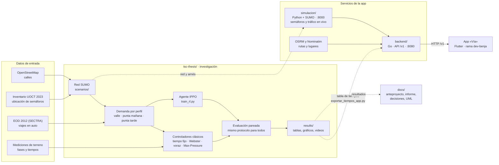
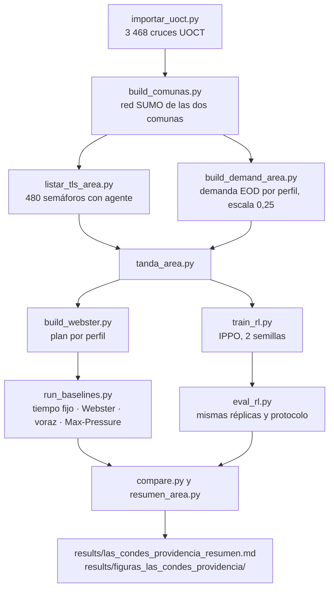

# Control adaptativo de semáforos mediante aprendizaje por refuerzo multi-agente

Proyecto de título — Ingeniería en Informática, DUOC UC
Gabriel Ignacio Cárdenas Valdés · Entrega: diciembre de 2026

## Qué es

Una plataforma para **comparar formas de controlar los semáforos de Santiago** en una
simulación de tráfico (SUMO): planes de **tiempo fijo**, métodos clásicos (**Webster**,
**voraz**, **Max-Pressure**) y **agentes que aprenden** con aprendizaje por refuerzo
multi-agente (**IPPO**, una red compartida por todos los semáforos).

Los resultados se llevan a una app móvil, **«Vía»**: el usuario marca un recorrido y la app
le muestra las rutas más rápidas según la hora y los semáforos que va a cruzar.

**Escenario principal (desde el 17-nov-2026):** las comunas completas de **Las Condes y
Providencia**, con 603 semáforos ubicados con el inventario oficial de la UOCT y demanda de
la Encuesta Origen-Destino 2012. El eje Alameda → Providencia → Apoquindo quedó como estudio
piloto.

## Cómo se conectan las partes



## Mapa del repositorio

| Sección | Qué es | Qué hace |
|---|---|---|
| [`tsc-thesis/`](tsc-thesis/README.md) | Plataforma experimental de la tesis (Python, SUMO, Stable-Baselines3) | Construye las redes y la demanda, corre los controladores, entrena y evalúa el agente, y produce las tablas y gráficos comparativos |
| [`backend/`](backend/README.md) | Backend de la app (Go 1.25, solo biblioteca estándar) | Expone la API `/v1`: lugares, rutas con sus semáforos, próximo semáforo, tráfico y viajes. Recomienda la ruta más rápida según la hora |
| [`simulacion/`](simulacion/README.md) | Servicio de simulación (Python, FastAPI, SUMO) | Corre la red en vivo y entrega al backend el color y la cuenta regresiva de cada semáforo y el tráfico por calle. Es el entorno de pruebas; en producción lo reemplazaría una fuente real |
| `docker-compose.yml` | Orquestación | Levanta backend y simulación juntos (`docker compose up --build`) |
| [`docs/`](docs/00-INDICE.md) | Documentación de la tesis | Anteproyecto, informe, decisiones registradas, datos, entorno, arquitectura, integración con la app y modelo UML |
| [`ESTADO_DEL_PROYECTO.md`](ESTADO_DEL_PROYECTO.md) | Informe de estado | Avance por objetivo, resultados y hoja de ruta |
| `capstone/` | Evidencias del ramo Capstone (APT122, fase 1) | Autoevaluaciones y diario reflexivo, con los scripts que los generan. Fuera del alcance técnico |

### `tsc-thesis/` en detalle

| Carpeta | Contenido |
|---|---|
| `src/tsc/` | La biblioteca. `sumo_env.py` envuelve la simulación; `runner.py` fija el protocolo de medición (calentamiento, muestreo, cierre) igual para todos; `metrics.py` calcula demora, colas y viajes terminados; `controllers/` tiene tiempo fijo, Webster, voraz y Max-Pressure; `rl_env.py` define el entorno multi-agente (observación, acción, recompensa, verde mínimo y máximo); `observations.py`, la observación por fase; `demand.py` elige qué demanda usa cada corrida |
| `scripts/` | Los pasos del trabajo, uno por archivo (ver tabla siguiente) |
| `scenarios/` | Una carpeta por red. **`las_condes_providencia/`**: escenario principal (603 semáforos, 82,8 km²). `eje_comunal/`: eje piloto. `apoquindo/`, `alameda_providencia/`, `providencia/`: corredores anteriores. `grid4x4/`: grilla sintética para pruebas |
| `data/` | `uoct/`: inventario de semáforos de la UOCT (GeoJSON y CSV). `terreno/`: mediciones propias en cruces. `waze/`: pruebas exploratorias, fuera de alcance |
| `results/` | Resultados de cada tanda en JSON, tablas (`*_resumen.md`), gráficos (`figuras_*/`), colas espacio-tiempo (`visual/`) y videos comparativos (`video/`) |
| `models/` | Modelos IPPO finales del área, con sus metadatos y curvas de aprendizaje |
| `tests/` | Pruebas del pipeline, la demanda, las métricas, el entorno RL y Webster (`make test`) |

| Grupo de scripts | Archivos | Para qué |
|---|---|---|
| Semáforos y red | `importar_uoct.py`, `build_comunas.py`, `emparejar_uoct.py`, `listar_tls_area.py`, `build_santiago.py`, `download_axis_osm.py`, `list_axis_tls.py`, `fix_tls.py`, `diagnose_net.py`, `medir_costo_red.py`, `build_grid.py` | Leer el inventario UOCT, armar la red desde OSM, semaforizar lo que falta, elegir qué semáforos controla el agente y revisar la red |
| Demanda | `build_demand_area.py`, `build_demand_eod.py`, `build_demand_profiles.py` | Viajes de la EOD por área o por eje, y perfiles sintéticos, con réplicas de entrenamiento y evaluación |
| Controladores clásicos | `build_webster.py`, `run_baselines.py`, `ajustar_baselines.py` | Planes de Webster por perfil y corridas de las líneas base con semillas pareadas |
| Agente | `train_rl.py`, `eval_rl.py`, `verificar_paridad.py`, `lanzar_entrenamiento.ps1` | Entrenar IPPO, evaluarlo con el mismo protocolo que las líneas base y verificar que ambos arneses midan igual |
| Tandas completas | `tanda_area.py`, `tanda_eod.py` | Webster → líneas base → entrenamiento → evaluación → comparación, en paralelo |
| Análisis y figuras | `compare.py`, `resumen_area.py`, `resumen_tanda_eod.py`, `resumen_visual.py`, `medir_colas_eje.py` | Pruebas estadísticas (Wilcoxon, IC 95 %), tablas y gráficos |
| Video | `record_run.py`, `video_comparativo.py` | Grabar corridas y comparar controladores lado a lado |
| Terreno | `procesar_terreno.py` | Pasar las mediciones de campo a los CSV de `data/terreno/` |
| App | `exportar_tiempos_app.py` | Exportar la tabla de velocidades por calle que usa el backend para estimar tiempos |
| `exploratorio/` | Waze y *rerouting* | Pruebas fuera del alcance de la tesis |

### Flujo de un experimento (escenario Las Condes + Providencia)



### `backend/` en detalle

| Carpeta | Contenido |
|---|---|
| `cmd/via-backend/` | Punto de entrada del servidor |
| `internal/api/` | Rutas HTTP `/v1`, middleware y formato de respuestas |
| `internal/servicios/` | Lógica de negocio: rutas con sus semáforos y recomendación según la hora, próximo semáforo, viajes GPS o simulados |
| `internal/proveedores/` | Clientes de OSRM, Nominatim y la simulación, más `historico/`, que estima tiempos con la tabla de la simulación |
| `internal/dominio/`, `internal/geo/`, `internal/almacen/`, `internal/config/` | Tipos del dominio, geometría, almacenamiento en memoria y configuración |
| `datos/` | `tiempos_eje.json`: velocidad por calle y franja horaria, exportada desde `tsc-thesis/` |
| `pruebas/` | Pruebas de humo de los endpoints (`via.http`, `probar-endpoints.ps1`) |

## Por dónde empezar

1. [`ESTADO_DEL_PROYECTO.md`](ESTADO_DEL_PROYECTO.md): dónde está el proyecto y qué sigue.
2. [`docs/00-INDICE.md`](docs/00-INDICE.md): índice de toda la documentación.
3. [`docs/datos/13-escenario-las-condes-providencia.md`](docs/datos/13-escenario-las-condes-providencia.md): escenario principal, demanda y últimos resultados.
4. [`tsc-thesis/README.md`](tsc-thesis/README.md): instalar y correr el pipeline.
5. [`docs/arquitectura.md`](docs/arquitectura.md): app, backend y simulación, y cómo levantarlos.

```bash
# Experimentos
cd tsc-thesis
pip install -r requirements.txt     # trae SUMO (eclipse-sumo); versiones fijadas
make test

# Servicios de la app
docker compose up --build           # backend en http://localhost:8080
```

## Ramas

| Rama | Contenido |
|---|---|
| `master` | Tesis, backend y simulación |
| `escenario-las-condes-providencia` | Escenario Las Condes + Providencia: red, demanda, tanda y resultados (pendiente de fusionar a `master`) |
| `dev-benja` | App «Vía» en Flutter y la API de tráfico con TomTom (`santiago-traffic-api`) |
| `main` | Evidencias de la fase 1 del equipo; historia separada |

Fuera de git, porque se regeneran con los scripts: descargas de OSM, archivos de rutas y
réplicas, microdatos de la EOD, checkpoints y logs de entrenamiento.
