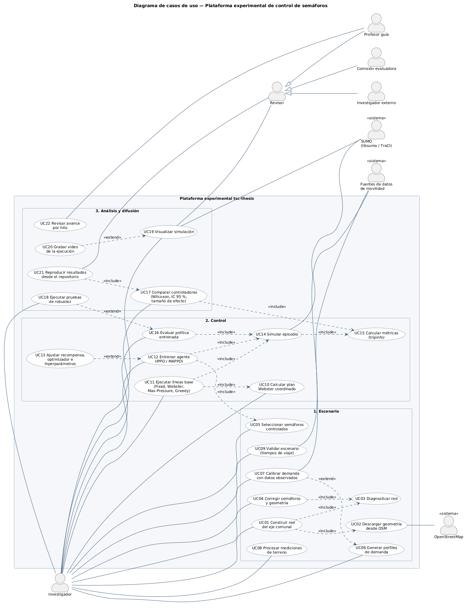
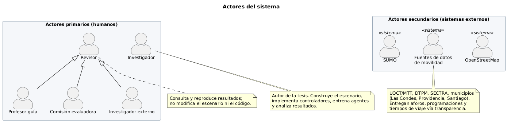
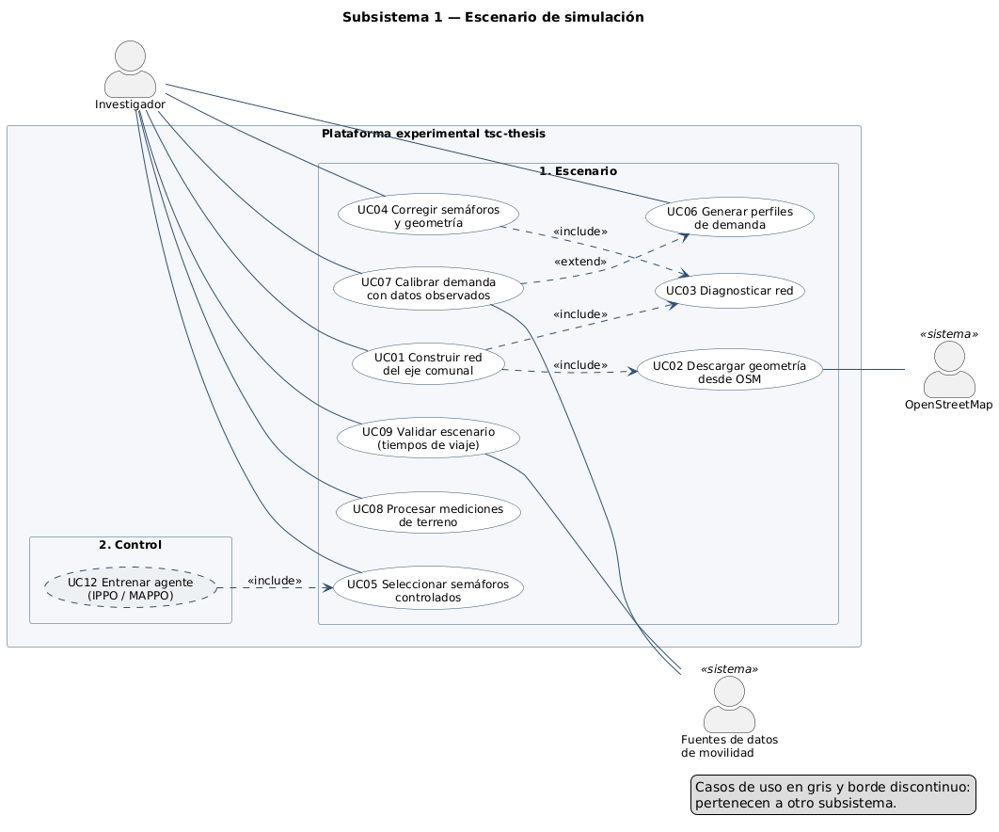
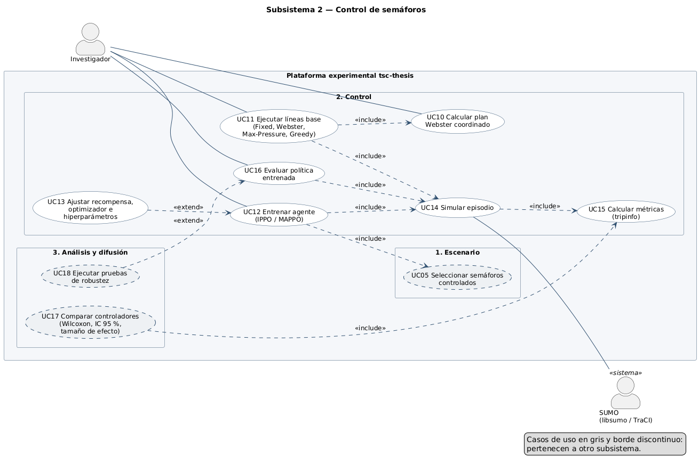
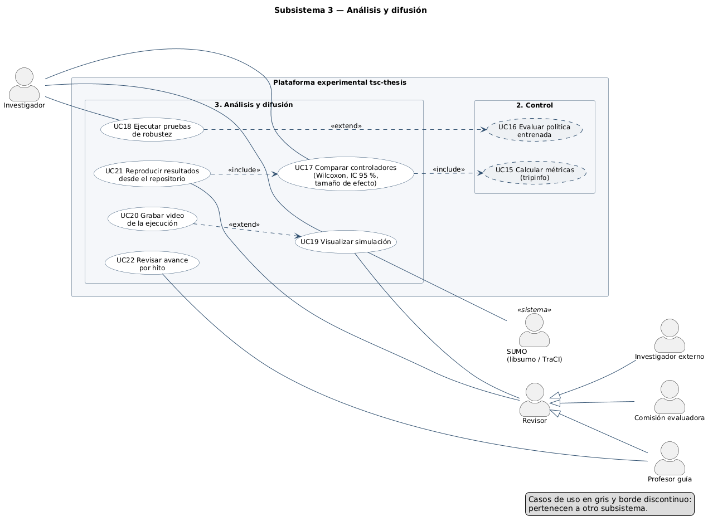

# Modelo de casos de uso — Plataforma experimental `tsc-thesis`

Control adaptativo de semáforos mediante aprendizaje por refuerzo multi-agente.
Modelo UML de actores y casos de uso, trazado contra el código del repositorio y
los objetivos específicos (OE) del anteproyecto. Estado al 29-oct-2026.

| Diagrama | Archivo |
|---|---|
| Actores | `actores.svg` / `.png` |
| Casos de uso — vista general | `casos-de-uso-general.svg` / `.png` |
| Subsistema 1 — Escenario | `casos-de-uso-escenario.svg` / `.png` |
| Subsistema 2 — Control | `casos-de-uso-control.svg` / `.png` |
| Subsistema 3 — Análisis y difusión | `casos-de-uso-analisis.svg` / `.png` |

Los `.puml` son la fuente. Los cuatro diagramas de casos de uso se generan desde un
único modelo en `gen.py`, para que no se desalineen entre sí:

```bash
python docs/uml/gen.py docs/uml                      # regenera los .puml
java -jar plantuml.jar -tsvg -charset UTF-8 docs/uml/*.puml
java -jar plantuml.jar -tpng -charset UTF-8 docs/uml/*.puml
```

`actores.puml` se edita a mano.



---

## 1. Frontera del sistema

El sistema es la **plataforma experimental** (`tsc-thesis/`): el escenario de
simulación, los controladores, el entorno de aprendizaje y el arnés de medición y
análisis. Quedan **fuera** de la frontera el simulador SUMO, OpenStreetMap y las
instituciones que entregan datos de movilidad: el sistema los usa, pero no los
controla. Tampoco hay semáforos reales: el anteproyecto excluye el despliegue en
infraestructura de la UOCT (§6.2).

## 2. Actores



| Actor | Tipo | Descripción | Objetivo principal |
|---|---|---|---|
| **Investigador** | Primario, humano | Autor de la tesis. Construye y depura el escenario, implementa los controladores, entrena y evalúa agentes, analiza resultados. | Obtener evidencia comparativa reproducible entre control clásico y aprendido. |
| **Revisor** | Primario, humano (abstracto) | Generalización de quien consulta el trabajo sin modificarlo. | Verificar que los resultados son correctos y reproducibles. |
| **Profesor guía** | Primario, humano (especializa a Revisor) | Supervisa el avance por hitos. | Evaluar el avance contra el cronograma sin depender de la percepción del autor. |
| **Comisión evaluadora** | Primario, humano (especializa a Revisor) | Evalúa el informe final y la defensa. | Juzgar la validez de las conclusiones. |
| **Investigador externo** | Primario, humano (especializa a Revisor) | Tercero que reutiliza el escenario o reproduce resultados. | Regenerar tablas y figuras desde el repositorio. |
| **OpenStreetMap** | Secundario, sistema externo | Fuente de la geometría vial y de la ubicación de los semáforos. | — |
| **Fuentes de datos de movilidad** | Secundario, sistema externo | UOCT/MTT, DTPM, SECTRA y municipios de Santiago, Providencia y Las Condes. Entregan aforos, programaciones semafóricas y tiempos de viaje (vía Ley 20.285). | — |
| **SUMO** | Secundario, sistema externo | Simulador microscópico (`libsumo`, o TraCI cuando hay interfaz gráfica). Ejecuta cada episodio. | — |

## 3. Catálogo de casos de uso

Estado: ✅ implementado · 🟡 parcial · ⏳ pendiente.

### Subsistema 1 — Escenario



| ID | Caso de uso | Actor(es) | Implementación | OE | Estado |
|---|---|---|---|---|---|
| UC01 | Construir red del eje comunal | Investigador | `build_santiago.py`, `scenarios/eje_comunal` | OE1 | ✅ |
| UC02 | Descargar geometría desde OSM | OpenStreetMap | `download_axis_osm.py` | OE1 | ✅ |
| UC03 | Diagnosticar red | — (incluido) | `diagnose_net.py` · `make diagnose` | OE1 | ✅ |
| UC04 | Corregir semáforos y geometría | Investigador | `fix_tls.py`, `netedit` | OE1 | ✅ |
| UC05 | Seleccionar semáforos controlados | Investigador | `list_axis_tls.py` → `tls_eje.json` (64 del eje) | OE3 | ✅ |
| UC06 | Generar perfiles de demanda | Investigador | `build_demand_profiles.py` · `make demand` | OE1 | ✅ |
| UC07 | Calibrar demanda con datos observados | Investigador, Fuentes de datos | — (los perfiles son sintéticos) | OE1 | ⏳ |
| UC08 | Procesar mediciones de terreno | Investigador | `procesar_terreno.py`, `data/terreno/` | OE1 | 🟡 |
| UC09 | Validar escenario (tiempos de viaje) | Investigador, Fuentes de datos | — | OE1 | ⏳ |

### Subsistema 2 — Control



| ID | Caso de uso | Actor(es) | Implementación | OE | Estado |
|---|---|---|---|---|---|
| UC10 | Calcular plan Webster coordinado | Investigador | `build_webster.py` · `make webster` | OE2 | ✅ |
| UC11 | Ejecutar líneas base | Investigador | `run_baselines.py` · `make baselines` | OE2, OE5 | ✅ |
| UC12 | Entrenar agente (IPPO / MAPPO) | Investigador | `train_rl.py` · `make train` (IPPO); MAPPO pendiente | OE3, OE4 | 🟡 |
| UC13 | Ajustar recompensa, optimizador e hiperparámetros | — (extiende UC12) | `train_rl.py --reward wait\|queue\|pressure\|speed --optimizer adam\|rmsprop --lr --lr-schedule` | OE4 | 🟡 |
| UC14 | Simular episodio | SUMO | `src/tsc/runner.py`, `sumo_env.py` | — | ✅ |
| UC15 | Calcular métricas (tripinfo) | — (incluido) | `src/tsc/metrics.py` | OE5 | ✅ |
| UC16 | Evaluar política entrenada | Investigador | `eval_rl.py` · `make eval` | OE5 | ✅ |

### Subsistema 3 — Análisis y difusión



| ID | Caso de uso | Actor(es) | Implementación | OE | Estado |
|---|---|---|---|---|---|
| UC17 | Comparar controladores | Investigador | `compare.py` · `make compare` | OE5 | ✅ |
| UC18 | Ejecutar pruebas de robustez | Investigador | — | OE6 | ⏳ |
| UC19 | Visualizar simulación | Investigador, Revisor, SUMO | `sumo-gui` · `make gui` | — | ✅ |
| UC20 | Grabar video de la ejecución | — (extiende UC19) | `record_run.py` · `make video` | — | ✅ |
| UC21 | Reproducir resultados desde el repositorio | Revisor | `make all`, `make test` | OE7 | 🟡 |
| UC22 | Revisar avance por hito | Profesor guía | `ESTADO_DEL_PROYECTO.md` | OE7 | ✅ |

### Relaciones

- **«include»** (obligatorio): construir la red incluye descargarla y diagnosticarla;
  toda corrección se cierra con un diagnóstico; líneas base, entrenamiento y evaluación
  incluyen simular un episodio, y todo episodio incluye calcular métricas con el mismo
  parser de `tripinfo` (un solo arnés de medición); entrenar incluye haber fijado los
  semáforos controlados; reproducir incluye la comparación estadística.
- **«extend»** (opcional): la calibración extiende la generación de demanda (sin datos
  reales, los perfiles quedan sintéticos y el diseño comparativo sigue siendo válido);
  el ajuste de hiperparámetros extiende el entrenamiento; la robustez extiende la
  evaluación; el video extiende la visualización.

---

## 4. Especificación de los casos de uso principales

### UC01 — Construir red del eje comunal

| | |
|---|---|
| **Actor primario** | Investigador |
| **Actores secundarios** | OpenStreetMap (vía UC02) |
| **Precondiciones** | Entorno instalado (`pip install -r requirements.txt`); acceso a `api.openstreetmap.org`. |
| **Postcondiciones** | `scenarios/eje_comunal/net.net.xml` existe y `diagnose_net.py` la declara APTA. |

**Flujo principal**
1. El investigador define la franja del eje (Matucana → término de Av. Apoquindo).
2. El sistema descarga la geometría en recuadros desde OSM (UC02) y calcula la franja.
3. El sistema convierte la geometría a red SUMO con `netconvert`.
4. El sistema ejecuta el diagnóstico (UC03): semáforos con una sola fase verde, arcos
   cortos entre semáforos, teletransportes y colisiones en una simulación de prueba.
5. El diagnóstico declara la red APTA.

**Flujos alternativos**
- *4a. El diagnóstico reporta problemas:* el investigador ejecuta UC04 y se repite el paso 4.
- *2a. Un recuadro excede el límite de nodos de la API de OSM:* el sistema lo parte en dos
  y reintenta. Los errores HTTP transitorios también se reintentan.

### UC11 — Ejecutar líneas base

| | |
|---|---|
| **Actor primario** | Investigador |
| **Actores secundarios** | SUMO (vía UC14) |
| **Precondiciones** | Escenario APTO; perfil de demanda generado (UC06); plan Webster calculado (UC10). |
| **Postcondiciones** | `results/<escenario>_baselines.json` con las métricas de cada controlador y semilla. |

**Flujo principal**
1. El investigador elige escenario, perfil y número de semillas.
2. Para cada controlador (Fixed, Webster, Max-Pressure, Greedy) y cada semilla, el
   sistema simula un episodio (UC14) con la **misma** semilla para todos los controladores.
3. Al cerrar cada episodio el sistema calcula las métricas desde `tripinfo` (UC15),
   incluida la demora de los vehículos no terminados (`delay_all_mean`).
4. El sistema guarda los resultados agregados.

**Flujos alternativos**
- *2a. La simulación registra teletransportes:* el sistema lo informa en el resultado;
  el investigador revisa la red (UC04) antes de usar esos números.

### UC12 — Entrenar agente (IPPO / MAPPO)

| | |
|---|---|
| **Actor primario** | Investigador |
| **Actores secundarios** | SUMO (vía UC14) |
| **Precondiciones** | Semáforos controlados fijados (UC05); perfil de demanda disponible. |
| **Postcondiciones** | Política guardada en `models/<escenario>/` con sus hiperparámetros y curva de aprendizaje. |

**Flujo principal**
1. El investigador elige escenario, perfil, pasos, recompensa y optimizador (UC13).
2. El sistema crea el entorno PettingZoo con un agente por semáforo del eje; las
   transversales operan en tiempo fijo.
3. El sistema entrena PPO con parámetros compartidos (IPPO), simulando episodios (UC14)
   con semillas de entrenamiento disjuntas de las de evaluación.
4. El sistema registra la curva de aprendizaje y guarda la política.

**Flujos alternativos**
- *3a. La curva no se estabiliza:* el investigador ajusta hiperparámetros (UC13).
- *3b. Regla de corte (22-nov):* si la política no iguala a tiempo fijo, se congela la
  exploración de arquitecturas y el esfuerzo pasa al análisis comparativo clásico.

**Restricciones:** verde mínimo, verde máximo y ámbar son restricciones duras del
entorno, no penalizaciones aprendidas.

### UC17 — Comparar controladores

| | |
|---|---|
| **Actor primario** | Investigador |
| **Precondiciones** | Resultados de líneas base (UC11) y de la política (UC16) con semillas pareadas. |
| **Postcondiciones** | Tabla comparativa con diferencia porcentual, prueba de Wilcoxon pareada, IC 95 % y tamaño de efecto. |

**Flujo principal**
1. El investigador indica los archivos de resultados.
2. El sistema empareja corridas por semilla.
3. El sistema calcula, por métrica y contra tiempo fijo, la diferencia, el valor p,
   el intervalo de confianza y el tamaño de efecto.
4. El sistema emite la tabla.

**Regla de negocio:** el valor p nunca se reporta sin intervalo de confianza y tamaño
de efecto.

### UC21 — Reproducir resultados desde el repositorio

| | |
|---|---|
| **Actor primario** | Revisor (Profesor guía, Comisión evaluadora o Investigador externo) |
| **Precondiciones** | Clon del repositorio en la rama `master`; Python 3.11+ con `requirements.txt`. |
| **Postcondiciones** | Las tablas del informe quedan regeneradas con los mismos valores. |

**Flujo principal**
1. El revisor instala dependencias y ejecuta `make test` para verificar el entorno.
2. El revisor ejecuta el pipeline (`make all` o los objetivos por etapa) con las
   semillas declaradas en el informe.
3. El sistema regenera resultados y la comparación estadística (UC17).
4. El revisor contrasta las tablas con las del informe.

**Flujos alternativos**
- *2a. Faltan archivos regenerables* (`map.osm`, recuadros OSM, `models/`): el revisor
  los regenera con los scripts indicados en `.gitignore`.
